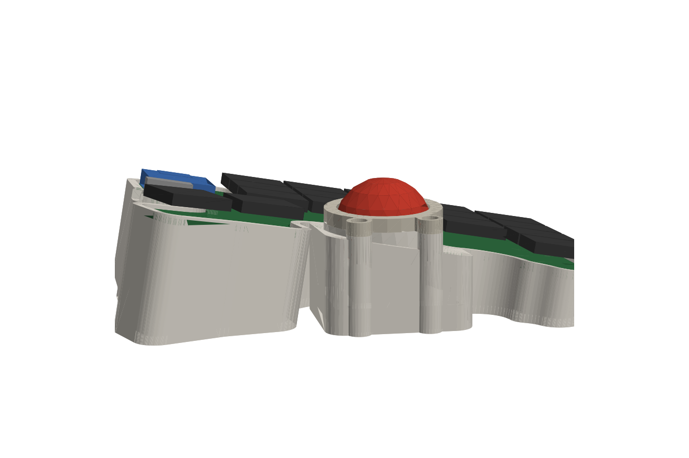
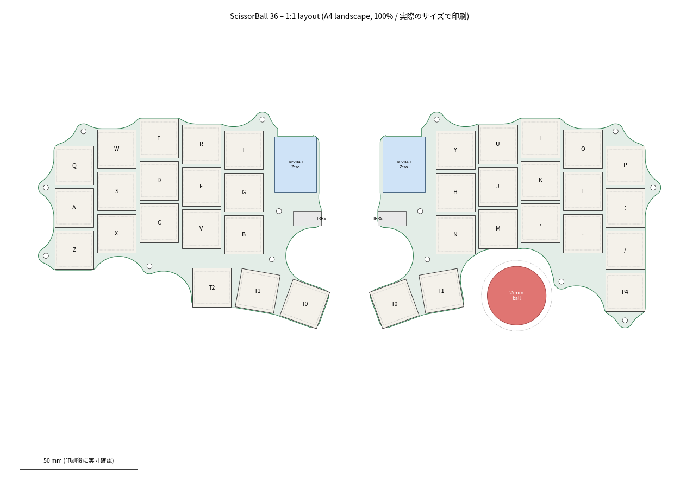

# ScissorBall 36

**ノートPCと同じシザー式スイッチを使った、低背の左右分割キーボード。右手親指でトラックボールを操作する。**
36キー・Kailh PG1425（X Switch）・25mm玉＋PMW3360・RP2040・QMK・TRRS有線

[English README](README.md) ・ [組立ガイド](docs/build-guide.ja.md)



> **状態：rev 1.0。設計済みで、DRC（設計ルール検査）もエラーなし。実機はまだ組んでいない。**
> 配線・DRC・3Dの干渉チェックはすべてソフト上で行った。発注前に[未検証の点](#未検証の点)を確認してほしい。

## 狙い

シザー式スイッチならキー面を薄くできるが、トラックボールはセンサーと玉を積み重ねるぶん、どうしても背が高くなる。その段差を次の3つで小さくした。

- 一般的な34mmではなく**25mmの玉**を使う
- センサーは**ケースの床に水平に**置く
- **キー基板だけを傾ける**（親指側を高くするテント10°＋手前を高くする傾斜5°）ことで、親指キーを玉の高さに近づける

| 机からの高さ（右手） | |
|---|---|
| 玉の上端 | 36.6 mm |
| 玉の隣の親指キー T1 | 31.6 mm → **段差 5 mm** |
| 最も内側の親指キー T0 | 35.5 mm |
| 最も低い角（小指の上段） | 13.4 mm |

傾けずに平らに作ると、キー上面は約11.5mmになり、玉との段差は約25mmになる。

## 仕様

| | |
|---|---|
| キー | 片手 5×3 ＋親指（左3・右2）＋右小指下1 ＝ 36 |
| ピッチ | 18×18mm、カラムスタッガード（Keyball39 を18mmピッチに換算） |
| スイッチ | Kailh PG1425（専用キーキャップが必要） |
| マイコン | Waveshare RP2040-Zero ×2（基板に平置き） |
| 左右接続 | TRRS、1線の半二重シリアル（GP1） |
| ポインティング | PMW3360（[monkeypad製ブレイクアウト](https://github.com/monkeypad/pmw3360-breakout)）＋25mm玉を φ2.5 のセラミック球3点で支える |
| ファーム | QMK。左右共通の `.uf2` 1ファイル（左右は GP29 で判定）、玉を動かすとマウス用レイヤーに自動で切り替わる、押している間スクロール |
| ケース | 3Dプリント（Bambu Lab P2S 向け、サポート不要） |



## 構成

```
hardware/pcb/left|right   KiCad 9 基板＋DRC結果＋基板STEP
hardware/pcb/lib          自作フットプリント
hardware/case             ケース・ベゼル（STEP / STL / 3MF）
production                ガーバーzip（左右別、JLCPCB向け）
firmware                  QMK 定義とビルド済み .uf2
docs                      組立ガイド、1:1 配置図・基板PDF、画像
tools                     生成スクリプト（tools/layout.py を変えると全部作り直せる）
```

回路図はない。ネットリスト（キーマトリクス、マイコンのピン割り当て、TRRS、センサー端子）は [`tools/pcb.py`](tools/pcb.py) に書いてあり、基板はそこから部品配置と配線まで自動で生成する。

## 作り方

部品表と手順は[組立ガイド](docs/build-guide.ja.md)にまとめてある。

1. `production/` のガーバーを左右別々に発注する（2層・1.6mm）
2. `hardware/case/` を印刷する（PETG/PLA、0.2mm、サポートなし。STEPを読み込むのがおすすめ）
3. `firmware/scissorball36_default.uf2` を左右のマイコンに書き込む
4. 組み立てる

## 再生成

```sh
make all KICAD_PY=<pcbnew が import できる python> FREECAD_PY=<FreeCAD が import できる python> FREEROUTING=/path/to/freerouting.jar
```

## 未検証の点

- **PG1425 のフットプリント**：コミュニティ製（modulo / shikamiya）を基に描き直し、modulo の STEP モデルとも照合した。ただし実物のスイッチでは確かめていない。`docs/pcb_*_1to1.pdf` を100%で印刷し、スイッチを当ててから発注すること。
- **レンズと玉の距離7.2mm**：組み立てモデルから出した値。追従が悪ければ、基準ボスを削るか薄いシムを挟んで調整する。
- **スイッチの入手性**：PG1425は在庫限りで売られていることが多い。基板より先に確保すること。
- TRRS には5Vが流れている。USBをつないだまま抜き差ししないこと。

## ライセンス

ハードウェア・ケース・ツール：GPL-3.0-or-later（フットプリントがGPL-3.0のものから派生しているため）
ファームウェア：GPL-2.0-or-later（QMK）
