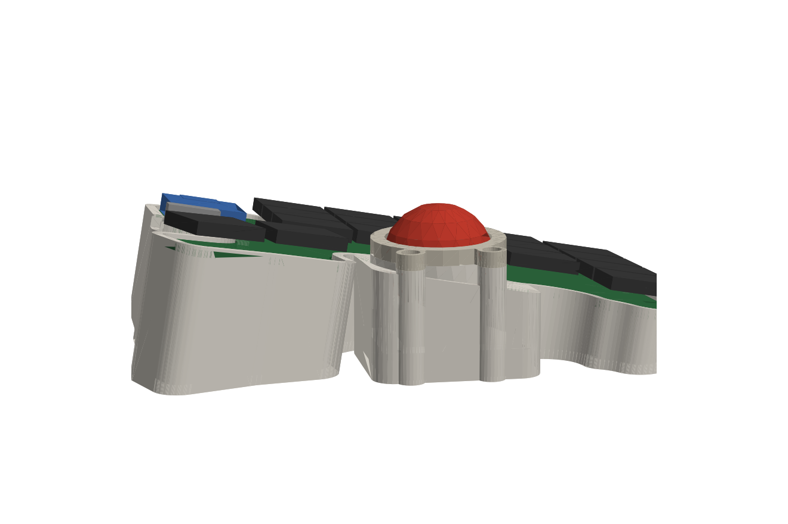
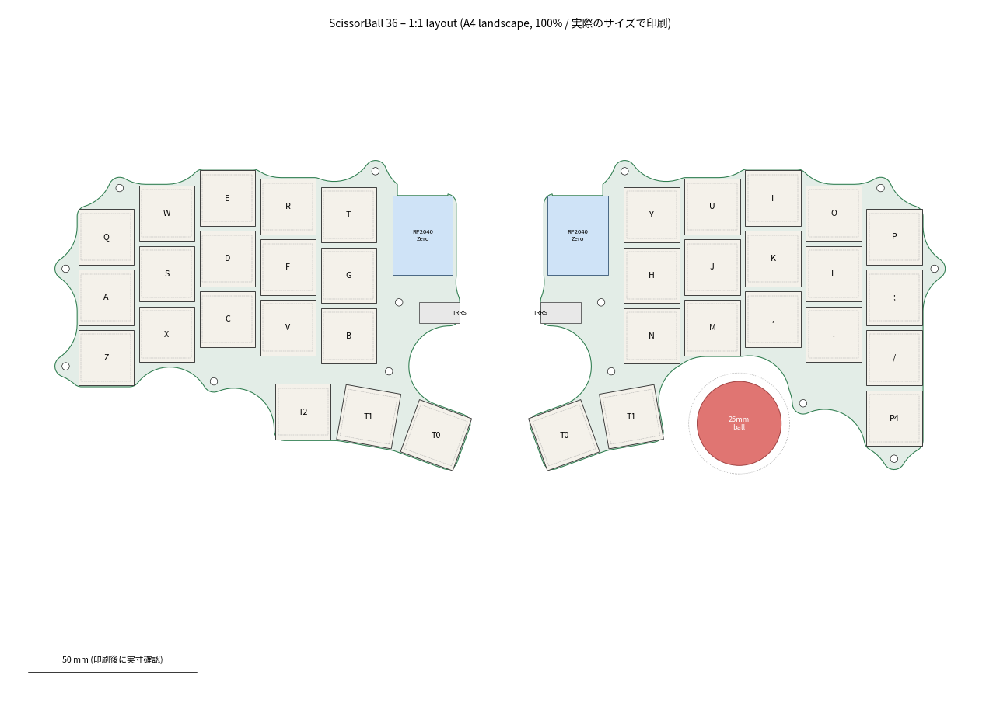
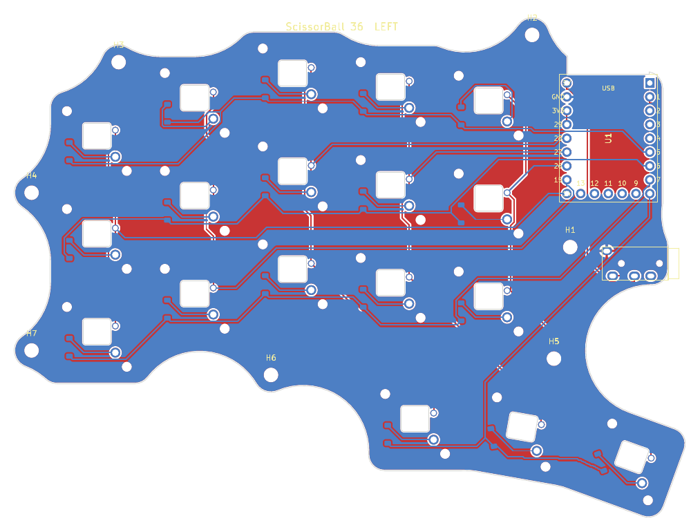
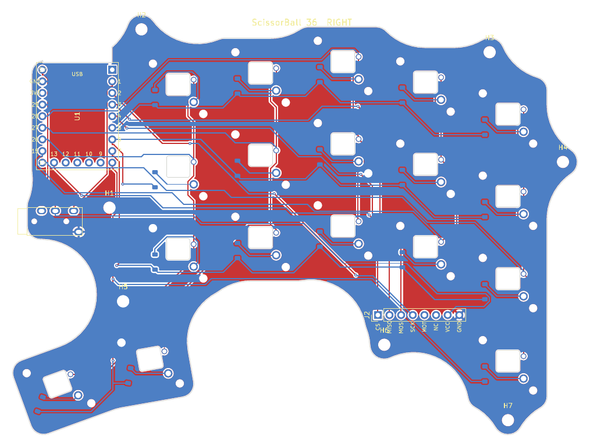

# ScissorBall 36

**A low-profile split keyboard with laptop-style scissor switches and a thumb trackball.**
36 keys · Kailh PG1425 “X-Switch” · 25 mm trackball (PMW3360) under the right thumb · RP2040 · QMK · wired (TRRS)

[日本語 README](README.ja.md) · [Build guide (日本語)](docs/build-guide.ja.md)



> **Status: rev 1.0 – designed, DRC-clean, not yet built.** Everything here is generated and checked in software
> (routing, DRC, 3D interference). No physical prototype exists yet – see [Known risks](#known-risks) before ordering.

## Why

Scissor switches keep the key field thin, but a trackball is inherently tall (sensor stack + ball).
ScissorBall keeps that step small by

- using a **25 mm ball** instead of the usual 34 mm,
- mounting the **sensor level on the case floor**, and
- **tilting only the key PCB** (10° tent toward the thumbs + 5° negative tilt), so the thumb keys rise to meet the ball.

| Height above desk (right half) | |
|---|---|
| Ball top | 36.6 mm |
| Thumb key next to the ball (T1) | 31.6 mm → **5 mm step** |
| Innermost thumb key (T0) | 35.5 mm |
| Lowest corner (pinky top row) | 13.4 mm |

A flat build would put the keys at ~11.5 mm, i.e. a ~25 mm step up to the ball.

## Specs

| | |
|---|---|
| Keys | 5×3 per hand + thumbs (left 3 / right 2) + 1 extra right-pinky key = 36 |
| Pitch / stagger | 18 × 18 mm, column stagger derived from Keyball39 |
| Switch | Kailh PG1425 (needs its dedicated scissor keycaps) |
| MCU | Waveshare RP2040-Zero ×2, mounted flat |
| Split link | TRRS, single-wire half-duplex serial (GP1) |
| Pointing | PMW3360 on the [monkeypad breakout](https://github.com/monkeypad/pmw3360-breakout), 25 mm ball on three Ø2.5 mm ceramic balls |
| Firmware | QMK, one `.uf2` for both halves (handedness pin GP29), auto mouse layer, drag-scroll |
| Case | 3D printed, fits a 256 mm bed (made for Bambu Lab P2S), no supports |



## Repository layout

```
hardware/pcb/left|right   KiCad 9 boards (.kicad_pro/.kicad_pcb) + DRC report + board STEP
hardware/pcb/lib          custom footprints (PG1425, RP2040-Zero, PJ-320A)
hardware/case             case halves + ball bezel (STEP / STL / 3MF)
production                gerber + drill zip per half (JLCPCB-ready)
firmware/scissorball36    QMK keyboard definition + default keymap
firmware/*.uf2            prebuilt firmware
docs                      build guide, 1:1 printable layout & PCB PDFs, images
tools                     generators – everything above is produced from tools/layout.py
```

There is no schematic: the netlist lives in [`tools/pcb.py`](tools/pcb.py) (switch matrix, MCU pin map, TRRS, sensor header) and the boards are placed and routed from it.

| PCB left | PCB right |
|---|---|
|  |  |

## Build it

1. **Order PCBs** – upload `production/scissorball_left_gerber.zip` and `..._right_...zip` separately (2 layers, 1.6 mm). The small rectangular cut-out under every switch is intentional (clearance for the switch’s bottom boss).
2. **Print** `hardware/case/*` – PETG or PLA, 0.2 mm, 3 walls, 15–20 % infill, no supports. Importing the STEP files into Bambu Studio gives the cleanest result.
3. **Flash** `firmware/scissorball36_default.uf2` to both RP2040-Zeros (hold BOOT while plugging in).
4. **Assemble** – see the [build guide](docs/build-guide.ja.md) (BOM, soldering order, sensor mounting).

### Parts (both halves)

| Part | Qty |
|---|---|
| Kailh PG1425 X-Switch with keycaps | 36 |
| Waveshare RP2040-Zero | 2 |
| 1N4148W diode, SOD-123 | 36 |
| PJ-320A TRRS jack + 4-pole cable | 2 + 1 |
| PMW3360 breakout (monkeypad, incl. sensor + LM19-LSI lens) | 1 |
| 25 mm trackball + Ø2.5 mm ceramic balls (Si3N4/ZrO2) | 1 + 3 |
| M2 self-tapping screws (4–6 mm) | 20 |
| Rubber feet ≥ 1.5 mm | 8 |

## Firmware

```sh
cp -r firmware/scissorball36 $QMK_HOME/keyboards/
qmk compile -kb scissorball36 -km default
```

Default keymap: QWERTY base, `NUM` (left inner thumb), `SYM` (right inner thumb), `FN` (right pinky extra key), and an auto-activating `MOUSE` layer (J/K/L = left/middle/right click, H or ; held = scroll). The sensor looks *up* at the ball, so axis orientation may need flipping – adjust `POINTING_DEVICE_ROTATION_*` / `POINTING_DEVICE_INVERT_*` in [`config.h`](firmware/scissorball36/config.h).

## Regenerating the design

Edit [`tools/layout.py`](tools/layout.py) (pitch, stagger, ball position, `TENT_DEG`, `TILT_DEG`) and run:

```sh
make all KICAD_PY=<python with pcbnew> FREECAD_PY=<python with FreeCAD> FREEROUTING=/path/to/freerouting.jar
```

`make pcb-left` places parts, autoroutes with Freerouting, closes any leftover connections with a small A* router (`tools/fixroute.py`) and runs DRC. `make check` verifies the case against the PCB, key caps (at rest and pressed), MCU, jack, sensor board and ball, and renders the previews.
Toolchain used: KiCad 9.0, FreeCAD 1.0, Freerouting 2.0, QMK 0.34.

## Known risks

- **PG1425 footprint** is re-drawn from community footprints ([moduloindustries](https://github.com/moduloindustries/libmodulo), [shikamiya](https://github.com/shikamiya/kicad-footprint-kailh-pg1425-x-switch)) and checked against modulo’s STEP model, but not against a physical switch. Print `docs/pcb_*_1to1.pdf` at 100 % and test-fit a switch first.
- **Lens-to-ball distance** (7.2 mm from the breakout’s lens-side face) is taken from a PMW3360 + LM19-LSI assembly model. If tracking is poor, shim or sand the four datum posts, or tune `PMW33XX_LIFTOFF_DISTANCE`.
- **Switch availability** – PG1425 is niche and often sold “while stocks last”. Secure switches before ordering boards.
- The TRRS line carries 5 V: never plug/unplug it while USB is connected.

## Credits

- Footprint geometry: [moduloindustries/libmodulo](https://github.com/moduloindustries/libmodulo) (GPL-3.0), [shikamiya/kicad-footprint-kailh-pg1425-x-switch](https://github.com/shikamiya/kicad-footprint-kailh-pg1425-x-switch) (MIT), [bobu01/RP2040-Zero-Kicad-Footprint-1mm](https://github.com/bobu01/RP2040-Zero-Kicad-Footprint-1mm) (GPL-3.0), [keebio/Keebio-Parts.pretty](https://github.com/keebio/Keebio-Parts.pretty) (MIT, PJ-320A)
- Layout proportions inspired by [Keyball](https://github.com/Yowkees/keyball); sensor board by [monkeypad](https://github.com/monkeypad/pmw3360-breakout)
- [QMK](https://qmk.fm), [KiCad](https://www.kicad.org), [FreeCAD](https://www.freecad.org), [Freerouting](https://github.com/freerouting/freerouting)

## License

Hardware, case and tools: **GPL-3.0-or-later** (see [LICENSE](LICENSE); footprints derive from GPL-3.0 sources).
Firmware (`firmware/`): **GPL-2.0-or-later**, as part of QMK.
